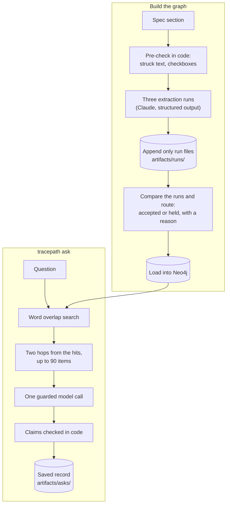

# tracepath

A terminal tool that answers "why was this built this way?" over a project's specs, with an answer whose every claim cites an item in a graph extracted from those specs.

## Example

This is eval question 1, asked against JobHunt's specs. The output below is copied from its saved record, [`artifacts/asks/2026-10-19T21-08-46Z-why-does-the-landing-rule.json`](artifacts/asks/2026-10-19T21-08-46Z-why-does-the-landing-rule.json). It ran under prompt `ask-1`. The search words, the 84 item lines and the record path are cut.

```text
$ uv run tracepath ask "Why does the landing rule's profile existence read (src/lib/landing-rule.ts) have its own dedicated query instead of reusing readOwnProfile(), which already reads the same row?" --ceiling 0.25
Question: Why does the landing rule's profile existence read (src/lib/landing-rule.ts) have its own dedicated query instead of reusing readOwnProfile(), which already reads the same row?
Items sent: 84 (16 hits, 68 neighbours, 0 cut).
...
Answer (verdict: answered):
  1. The landing rule uses a dedicated existence read because readOwnProfile()'s record_not_found path reports to Sentry and marks the profile.read span failed. An absent profile row is a normal case for the landing rule, so its read returns false and builds no failure(). [0008/AC-7] read from text
  2. The dedicated read is a new named export beside readOwnProfile() in src/features/profile/queries.ts, because it queries that feature's table. The landing rule in src/lib/landing-rule.ts imports it from there. [0008/AC-5b] [0008#build-plan:6] read from text
  3. The exemption is narrow. A genuine query error is still a failure: the read goes through attempt(), and an error is never collapsed into false. On an errored read the landing rule sends the visitor to /search. [0008/AC-7a] read from text
  4. The existence read and the AC-7a error handling are built together with the landing rule. [0008#build-plan:6] [0008/AC-7] [0008/AC-7a] link
Cost: 1 call, 22,681 in, 402 out, $0.0494 by recorded usage, $0.0494 by the guard's rule, ceiling $0.25.
```

Each id in brackets is a graph item: `0008/AC-7` is acceptance criterion AC-7 of spec 0008, and `0008#build-plan:6` is an item from that spec's build plan. Code sets the mark after each claim, never the model:

- `read from text`: the claim rests on what the cited item's own text says. Code checks the id was among the items sent. It does not check that the text says what the claim says.
- `link`: code found a link, among those sent, joining the cited items.
- Other marks appear only when a check fails or an item is out of date: `INFERRED`, `HISTORY`, `CITATION REJECTED`, `UNCITED`, `unsupported`.

## Setup

Needs Python 3.12 or later, [uv](https://docs.astral.sh/uv/), and Docker.

```sh
cp .env.example .env        # then set NEO4J_PASSWORD (8 characters or more)
docker compose up -d        # Neo4j 5; Browser at http://localhost:7474
uv sync
uv run tracepath status     # checks that Neo4j is reachable
```

The graph holds no state of its own. It is rebuilt from the JSON run artifacts, so the container has no volume and can be thrown away.

Add `--debug` before any command for debug logging, e.g. `uv run tracepath --debug status`.

## Usage

Run tracepath from the repository root with `uv run`. The extracted corpus is already committed, so you only need to load it. Loading makes no API call.

```sh
uv run tracepath load                                  # build the graph from artifacts/runs/
uv run tracepath ask "QUESTION" --dry-run              # free: shows the items found and prices the call
uv run tracepath ask "QUESTION" --ceiling 0.25         # one paid call, at most $0.25
```

`ask` needs `ANTHROPIC_API_KEY` in `.env`. It prints the items it found, then the answer, then the cost, and saves a record under `artifacts/asks/`.

- `--dry-run` finds the items and prices the call from the free token count endpoint. It makes no call and writes no record, so it needs no ceiling.
- `--ceiling USD` is required for a real call. `ask` works out the most the call could cost before making it, and stops if that is above the ceiling.

The answer's verdict is one of four:

- `answered`: the claims answer the question.
- `partly`: the claims answer only part of it. `Missing:` lists what the items did not hold.
- `not_supported`: the items found do not support an answer.
- `no_documented_link`: the question asks how two things connect, the items for each were found, and nothing in them states a connection. It means the records state no link, not that none exists.

## How it works



Extraction reads JobHunt's specs, pinned at commit `2e40bcf`, one section at a time. Code first marks struck text and checkboxes. The model then reads each section three times, and each run is saved as a JSON file that is never overwritten. Loading compares the three runs. An item all three runs agree on is accepted, including one held only by a warning flag or by a link waiting on another item (the narrow hold rule, on by default). Items the runs disagree on, or that fail another check, are held, each with the reason. Held items still load, marked held.

At question time, code picks the question's words, finds up to 16 items that share them, and adds their neighbours up to two hops away, at most 90 items in all. It prices the call before making it, makes one call, then checks every cited id against the items it sent, and saves the whole exchange.

The search runs over the extracted items, not the raw documents. That is what makes each citation point at one exact criterion, with its file and line, and what lets an answer label a struck or replaced item as history instead of quoting it as current. Following links brings in connected items that use different words, such as the criterion that replaced an old one.

## What I tried first

I first tried LangChain's `LLMGraphTransformer`, with default settings, on four JobHunt files ([experiment 0007](experiments/0007-langchain-graph-transformer-baseline/README.md)). It dropped the acceptance criterion ids, so AC-7 and AC-16 never became nodes. It gave one feature three identities with nothing linking them. I already had an extraction pipeline from earlier work, with closed vocabulary types, a validator and a run comparator, tested on this corpus, and this test confirmed that a general purpose library failed on the same data.

The first version answered a question by walking from a start item along the graph's links. After extracting the whole corpus, the walk passed 1 of the 5 eval questions, and that one was the question whose right answer is "no documented connection" ([experiment 0015](experiments/0015-whole-corpus-run/README.md)). The other chains broke where one document should have led to another.

So I tried answering at question time by hand: a session played the model's part on the five eval questions, with no API call. I marked its answers 4 right and 1 partly right. One hand run is too small to count as a measurement, but it was enough to redesign `ask` around retrieval plus one cited answer ([spec 0009](docs/specs/0009-answer-at-question-time/index.md)).

## Results

I asked each question once, on `claude-sonnet-5-5` with prompt `ask-1`.

- Development set (the 5 eval questions): 5 of 5 answered right.
- Held out set (4 questions): 3 answered right and 1 partly right. The partial one was a retrieval miss: the item holding the answer sat more than two hops from the hits, so it was never sent.
- Nine calls cost $0.38 in all.

I froze the prompt in a commit before running the held out questions, and the tool refuses to ask a held out question a second time once it has an answer. I judged every answer myself against expected answers written down before the run.

After the held out run, I added the `no_documented_link` verdict as prompt `ask-2`. Only eval question 4 was asked again under it. The held out questions were not.

## How I evaluated and controlled it

### A deterministic eval runner

`tracepath eval` scores each eval question pass, fail or inconclusive, and gives the reason for every expected item it did not reach. It reads the committed graph and makes no API call, so anyone can rerun it ([spec 0006](docs/specs/0006-eval-runner/index.md)).

### A spend fence

Every paid call in the tool goes through a guard that bounds it against a ceiling before the call is made. A test in CI, [`tests/test_spend_fence.py`](tests/test_spend_fence.py), fails if any file outside its allowlist imports the Anthropic SDK. Every test runs with a fake key and an unreachable API.

### Provenance

Each run file records the model, the prompt version, the corpus commit and the token usage. Run files are append only: a newer run never replaces an older one, and superseded runs move to `artifacts/superseded/` instead of being deleted. So the cost of any run can be recomputed from the repository.

### An experiment log

[`experiments/`](experiments/) holds 15 records. Seven of them committed a prediction, a decision rule or a blinded ruling sheet before the results existed. Each is scored as written, and the misses stay in.

## Specs and experiments

| Record | Outcome |
| --- | --- |
| [Spec 0001](docs/specs/0001-stack-and-architecture/index.md): stack and architecture | Python, Neo4j in Docker, and Claude with structured outputs. |
| [Spec 0002](docs/specs/0002-data-model/index.md): data model | Records, extracted items and unresolved names as nodes, with typed links. Three runs per section, compared in code. |
| [Spec 0003](docs/specs/0003-extraction-stability-heterogeneous-units/index.md): extraction stability | Worked examples in the prompt cut disagreement between runs on links. Accuracy stayed open. |
| [Spec 0004](docs/specs/0004-first-traced-chain/index.md): first traced chain | `extract`, `load` and `trace` built end to end, with a spending ceiling on every call. |
| [Spec 0005](docs/specs/0005-held-item-view/index.md): held item view | Held items load into the graph, marked held. |
| [Spec 0006](docs/specs/0006-eval-runner/index.md): eval runner | `tracepath eval` scores every question with no API call. |
| [Spec 0007](docs/specs/0007-extraction-accuracy/index.md): extraction accuracy | Model moved to `claude-sonnet-5-5`. The code pass it tested stays off. |
| [Spec 0008](docs/specs/0008-review-volume-and-routing-policy/index.md): review volume and routing | Two rules committed before measuring. Both were met, so both became defaults. |
| [Spec 0009](docs/specs/0009-answer-at-question-time/index.md): answer at question time | `tracepath ask`. 5 of 5 development questions right, 3 of 4 held out right and 1 partly right. |
| [Experiment 0005](experiments/0005-held-out-prompt-examples/README.md): worked examples | Link disagreement between runs fell in all three groups, but the accuracy bar failed on 5 of 6 results. |
| [Experiment 0006](experiments/0006-accuracy-bar-recheck/README.md): accuracy bar recheck | The bar failed on 3 of 6 results after the prompt fix. |
| [Experiment 0007](experiments/0007-langchain-graph-transformer-baseline/README.md): LangChain baseline | Acceptance criterion ids lost, one feature split into three unlinked identities, 86 ad hoc link types. |
| [Experiment 0011](experiments/0011-eval-runner/README.md): first full eval | No question passed. |
| [Experiment 0014](experiments/0014-review-volume-and-routing-policy/README.md): routing policy | Both defaults flipped under the rule committed before the run. |
| [Experiment 0015](experiments/0015-whole-corpus-run/README.md): whole corpus run | The walk passed 1 of 5, the absence question. This led to the redesign. |

## License

MIT. See [LICENSE](LICENSE).
