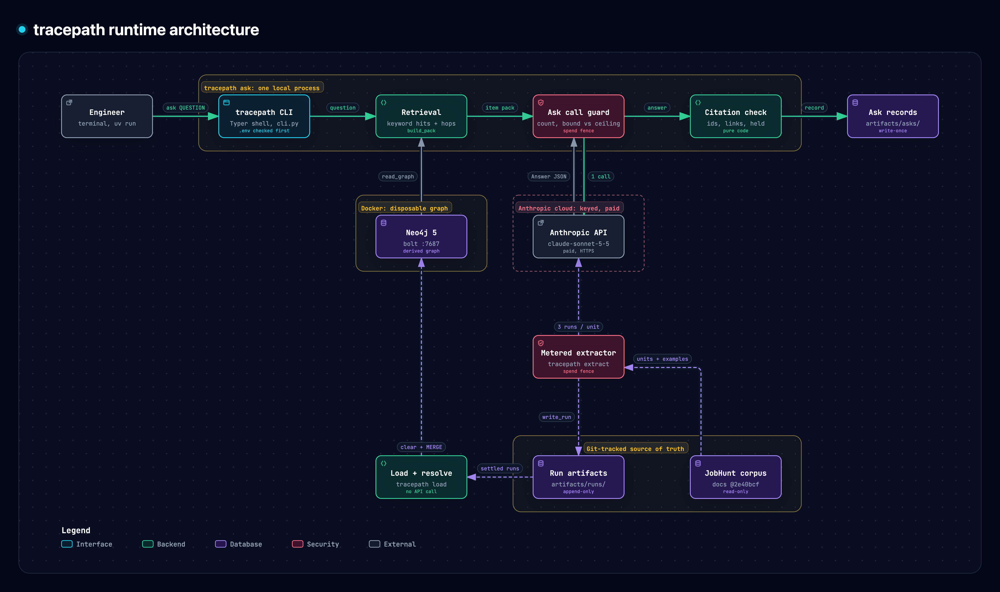

# tracepath: a case study

tracepath is a terminal tool I built to answer "why was this built this way?" from a project's specs. Each answer cites the items it rests on, and code checks every citation.

## The problem

A project's reasons live in its decision records. In JobHunt, the project I used as the corpus, a rule in one spec can be amended, struck or replaced by a criterion in another. Ask why the code does something and the honest answer can span three files and a dated correction.

A passage read on its own loses this. A struck criterion looks current, and one spec names another only by a number or a nickname. I wanted answers that point at one criterion, with its file and line, and that say when something is history.

## What I tried first

I started with LangChain's `LLMGraphTransformer` at default settings on four JobHunt files. It dropped the acceptance criterion ids, so AC-7 and AC-16 never became nodes. It gave one feature three identities with nothing linking them ([experiment 0007](../experiments/0007-langchain-graph-transformer-baseline/README.md)). That run used the library as it comes, with no custom types or prompt.

I moved to my own extraction pipeline, with closed types for items and links ([spec 0002](specs/0002-data-model/index.md)). The model reads each section three times, and code compares the runs. Items the runs agree on are accepted; the rest are held, each with a reason.

The first version answered by walking the graph from a start item. After I extracted the whole corpus, the walk passed 1 of the 5 eval questions, the one whose right answer is "no documented connection". The other chains broke where one document should have led to another ([experiment 0015](../experiments/0015-whole-corpus-run/README.md)).

## The redesign

Next I prototyped by hand: a session played the model's part on the five eval questions, with no API call. I marked its answers 4 right and 1 partly right. One hand run is only a hint, but it was enough to redesign the command ([spec 0009](specs/0009-answer-at-question-time/index.md)).

In `tracepath ask`, code picks the question's words and finds up to 16 extracted items that share them. It adds their neighbours up to two link hops away, at most 90 items in all. It prices the call before making it and refuses if the price could pass the ceiling. It makes one call, then checks every cited id against the items it sent. A claim that says two items are linked must cite two items joined by a link that was sent, or it prints as `INFERRED`.

## The result

I asked each question once, on Claude Sonnet 5.5 with prompt `ask-1` ([v1 finish line](scope/scope.md#v1-finish-line)).

- Development set, 5 questions: 5 of 5 right.
- Held out set, 4 questions: 3 right and 1 partly right. The partial one was a retrieval miss: the item holding the answer sat more than two hops from the hits, so it was never sent.
- The nine calls cost $0.38.

I froze the prompt in a commit before the held out run. The tool refuses to ask a held out question twice. I judged every answer myself against expected answers written down before the run. The held out questions all sit in a small cluster of records, so that pass is a narrow check.

## Against my earlier tool

Before tracepath I built decision-memory. On OpenAI, it fuses keyword and embedding search over spec chunks, drafts an answer, then checks each sentence against its sources. I ran it on the same nine questions ([experiment 0017](../experiments/0017-decision-memory-comparison/README.md)).

It abstained on all nine. Its search reached the expected spec records on eight of the nine. Its claim verifier removed drafted sentences, which left part of each question uncovered. tracepath answered all nine with cited claims, 8 right and 1 partly right.

This compares two whole systems, which differ in search, checks, model provider and inputs: four of the nine expected chains cite a file decision-memory never reads. It says nothing about keyword or vector search on their own.

## What the links do

To see whether the graph's links help find what an answer needs, I asked the five development questions again with links turned off ([experiment 0016](../experiments/0016-link-hops/README.md)). I wrote the decision rule down before any paid call.

All five answers stayed right without links, so on these questions the word search alone found what they needed. The links still let an answer label a replaced item as history and cite what replaced it, and they back the code checked link marks on claims. I kept the default at two hops, since held out question 3 shows that some answers sit further out.

## How I kept it controlled

The eval runner scores each eval question pass, fail or inconclusive from the committed graph. It makes no API call, so anyone can rerun it ([spec 0006](specs/0006-eval-runner/index.md)).

The spend fence bounds every paid call in the tool against a ceiling before the call is made. A CI test, [`tests/test_spend_fence.py`](../tests/test_spend_fence.py), fails if a file outside its allowlist imports the Anthropic SDK. Every test runs with a fake key and an unreachable API.

Each append only run file records the model, prompt version, corpus commit and token usage.

The [experiment log](../experiments/) holds 17 records. Several, including [0011](../experiments/0011-eval-runner/predictions.md), [0014](../experiments/0014-review-volume-and-routing-policy/README.md), [0015](../experiments/0015-whole-corpus-run/README.md) and [0016](../experiments/0016-link-hops/README.md), committed a prediction or a decision rule before the results existed. The misses stay in.

## What I'd do next

First, a second search. When an answer lists what it is missing, search again on those words and send the new items. Held out question 3 is the case for it ([spec 0009, Follow-up](specs/0009-answer-at-question-time/index.md#follow-up)).

Second, better link resolution. Feature 7 matches records that name the same thing by number, nickname or file name. Feature 8 follows supersession and correction so a replaced fact never comes back as current ([scope](scope/scope.md)). After either lands, I would rerun experiment 0016 against its baseline.
